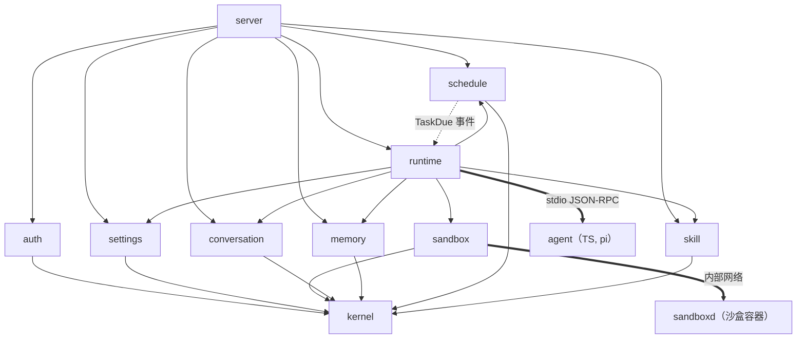
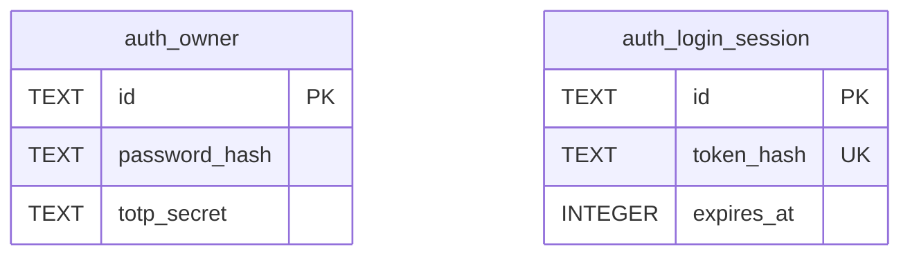
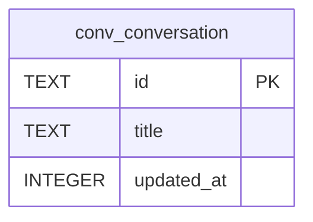

# 架构

模块化单体（Rust）+ 无状态 agent 子进程（TS）+ 沙盒容器。技术细节见 docs/stack.md，上下文管理见决策 005。

## 模块图

依赖方向：server → runtime → 业务/平台模块 → kernel。同层模块互不依赖；schedule 通过事件通知 runtime，不反向调用。

## 模块与表
| 模块 | 职责 | 拥有的表 |
|---|---|---|
| kernel | ID、时间、错误基础类型 | — |
| auth | 主人密码、TOTP、登录会话 | auth_owner, auth_login_session |
| settings | 个人资料、系统偏好、供应商/搜索 Key、默认模型 | settings_profile, settings_preference, settings_credential |
| sandbox | sandboxd 客户端 | — |
| conversation | 会话、消息、运行、压缩摘要 | conv_conversation, conv_message, conv_run, conv_compaction |
| memory | 核心记忆、记忆条目（FTS5） | mem_core, mem_entry |
| schedule | 定时任务、触发记录，发 TaskDue | sched_task, sched_fire |
| skill | 预设/已装技能目录与索引、Git 安装 | skill_installed |
| runtime | agent 进程、RPC、上下文组装、工具分派 | — |
| server | 组装根 | — |
| sandboxd | 沙盒内执行服务 | — |

## 新功能放哪
| 要加的东西 | 放哪 |
|---|---|
| 新的 agent 工具 | 工具定义在 agent/src/tools；需要数据或副作用的，在对应 Rust 模块 api 加函数，由 runtime 分派 |
| 新的模型供应商 | settings 加凭据类型；agent 侧注册 pi-ai provider |
| 新的设置页项目 | settings 模块 + web/src/pages/settings |
| 新的预设技能 | agent/skills/builtin/<name>/SKILL.md |
| 第三方账号连接（M2） | 新模块 connector，依赖 settings 存密钥 |
| 上下文策略调整 | runtime（组装）+ conversation（存储），先改决策 005 |

## 横切能力结论
| 能力 | 结论 | 位置 |
|---|---|---|
| 认证 | 服务端会话 Cookie（HttpOnly、SameSite=Strict）+ 可选 TOTP；App 以后用长期令牌 | auth + server 中间件 |
| 授权 | 单人，无角色；登录即全部权限 | server 中间件 |
| 数据权限 / 多租户 | 不做 | — |
| 审计日志 | 记录登录、改密钥、改设置；agent 的工具调用记在 conv_run 事件里 | auth、settings、conversation |
| 配置 | 环境变量 OWNMIND_*，启动校验，错就失败 | server |
| 密钥 | 供应商 Key 用 /data/master.key 加密后入库；仓库只有 .env.example | settings |
| 文件存储 | 本地卷；沙盒工作目录独立 | sandbox |
| 缓存 | 不做 | — |
| 异步与定时 | tokio 任务；定时任务每次触发写 sched_fire，失败可见可重试，幂等按 fire ID | schedule + runtime |
| 通知 | MVP 只在管理页面内（运行完成标记）；推送随 App | conversation |
| 国际化 | 做：中文、英文从第一天起，文案进资源文件 | web |
| 菜单路由 | 前端静态路由（单人无权限差异） | web |
| API 契约 | Rust 类型为源，ts-rs 生成 TS；HTTP + SSE 推送运行事件 | server、runtime |
| 可观测性 | tracing 结构化日志带请求/运行 ID；/healthz、/readyz | server |

## 数据
物理 schema 以 `crates/*/migrations/` 为准；主键 UUIDv7 文本、时间 UTC 毫秒（决策 007）。跨模块只存 ID，不建外键。

### auth

auth_owner 至多一行（`is_singleton` 唯一约束）；登录会话只存令牌哈希。

### conversation

计划中：conv_message、conv_run、conv_compaction（随 M1 聊天票加入）。
